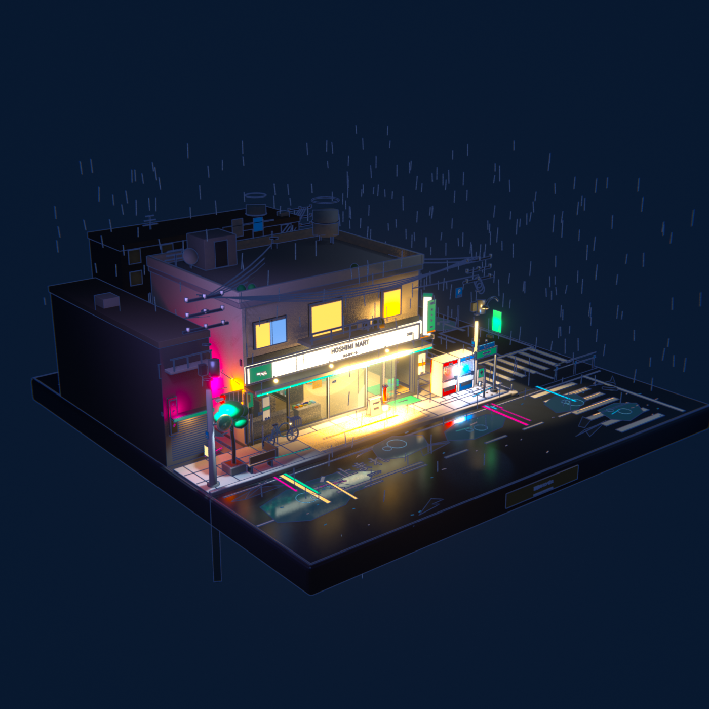
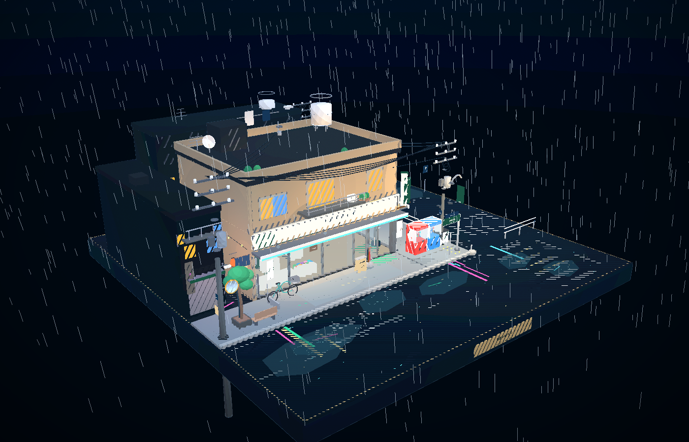
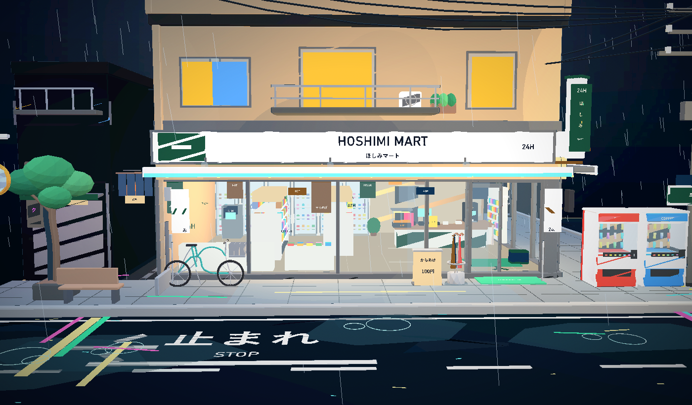

# 雨夜便利店 · HOSHIMI MART

一个以正方形底座承载的日式街角便利店微缩场景。整体是可在浏览器中自由旋转、缩放、平移观看的 3D 小品，无人物、无 UI，采用三渲二（cel-shaded）夜景风格，并带有从地面逐层装配成完整场景的入场动画。

## 项目名称

**雨夜便利店 · HOSHIMI MART**（项目目录：`rainy_konbini`）

## 项目简介

项目由 **Blender 场景源文件 + 静态 Web 查看器** 两部分组成：

- Blender 负责建模、材质、灯光、构图、Freestyle 墨线和 288 帧装配动画。
- Web 查看器负责把导出的 GLB 以 Three.js 实时渲染出来，支持鼠标/触控交互，并根据每个构件的 `asm_*` 参数重新播放装配动画。

场景主体为位于街角的便利店：大面积玻璃橱窗与自动门、灯箱招牌、雨棚、自动贩卖机、自行车、雨伞架、垃圾桶、路灯、电线杆与电线、路牌、护栏、停车位、排水沟、积水与反光斑马线、小巷入口、空调外机、公告栏等。店内可见货架商品、杂志、冷柜饮料、ATM、收银台、热食柜、咖啡机和悬挂海报。

## 项目功能

- 正方形完整底座，微缩模型式构图。
- 三渲二夜景：柔和主色、明确轮廓、暖色店内光与冷色夜街对比。
- 便利店内部可透过大面积玻璃清楚看到。
- 日式街角元素密集但分区明确：街道、店头、侧巷、屋顶与背景建筑。
- 交互查看器：左键拖拽旋转、滚轮缩放、右键拖拽平移。
- 自动装配动画：从底座和地面开始，逐层加入建筑、店内陈设、外摆、招牌、电线和雨。
- 装配完成后场景缓慢自转；用户一旦开始拖拽即停止自动旋转。
- 无按钮、无标题栏、无 HUD，页面本身就是模型。
- 离线可用：查看器不需要 CDN、后端或网络请求。

## 技术栈

| 层 | 技术 |
| --- | --- |
| 3D 建模 / 动画 / 渲染 | Blender 5.2.x，Python `bpy` API，EEVEE，Freestyle |
| 材质与画面 | Principled BSDF、发光材质、Standard 色彩管理、Fog Glow 合成辉光 |
| 模型交换格式 | glTF 2.0 二进制（`.glb`） |
| Web 渲染 | Three.js r128（本地 vendor，不使用 CDN） |
| 交互 | OrbitControls、Pointer / Wheel 事件 |
| 后处理 | EffectComposer + UnrealBloomPass |
| 资源内嵌 | 构建脚本将 GLB 转为 Base64 写入 `viewer/scene_data.js`，避免 `file://` 下的 CORS 限制 |
| 辅助构建 | Node.js 内置 `fs` / `path`，无 npm 第三方依赖 |

## 项目截图







## 项目目录结构

```text
rainy_konbini/
├─ README.md
├─ LICENSE
├─ THIRD_PARTY_NOTICES.md
├─ .gitignore
├─ .gitattributes
├─ build_scene.py          # Blender 场景生成与装配动画
├─ scene_lib.py            # Blender 建模/材质/渲染辅助库
├─ export_glb.py           # 将最终装配帧导出为 GLB（含 asm_* extras）
├─ render_stills.py        # 渲染最终效果图与店头近景
├─ rainy_konbini.blend     # Blender 源文件（含完整动画）
├─ rainy_konbini.glb       # 静态装配完成模型
├─ tools/
│  └─ embed_glb.js         # 将 GLB 重新嵌入 viewer/scene_data.js
├─ viewer/
│  ├─ index.html
│  ├─ viewer.js
│  ├─ scene_data.js        # 自动生成：Base64 内嵌的 GLB
│  └─ vendor/              # Three.js r128 及示例模块
└─ renders/
   ├─ rainy_konbini_hero.png
   ├─ konbini_storefront.png
   ├─ viewer_final.png
   └─ viewer_close.png
```

## 环境要求

### 仅查看场景

- 桌面版 Chrome / Edge / Firefox 等支持 WebGL 的现代浏览器。
- 不需要 Node、Python、Blender 或网络连接。

### 重新构建 / 渲染

- Blender **5.2.x**（脚本使用了 Blender 5.2 的合成器节点组、EEVEE 和 glTF 导出接口）。
- Node.js **18+**（仅用于 `tools/embed_glb.js`）。
- Python 3 仅用于可选的本地静态服务器。
- 重建 Blender 场景时使用了 Windows 字体 `Yu Gothic Bold` 与 `Bahnschrift` 做招牌文字；在非 Windows 环境需修改 `scene_lib.py` 中的字体路径或替换字体。字体文件不随仓库分发。已导出的 `.blend` / `.glb` / Web 查看器不依赖这些字体。

## 安装方法

```bash
# 将 <你的仓库地址> 替换为上传后的实际地址
git clone <你的仓库地址>
cd rainy_konbini
```

本项目查看器不依赖 npm 包；`viewer/vendor/` 中已经包含所需 Three.js 文件，无需 `npm install`。

## 运行方法

### 方式一：直接打开（推荐）

双击 `viewer/index.html`，或把它拖入浏览器窗口。

页面完全离线运行。第一次打开时浏览器需要解码约 18 MB 的内嵌 GLB，可能需要短暂等待。

### 方式二：本地 HTTP 服务

在项目根目录执行：

```bash
python -m http.server 8124 --directory viewer
```

然后打开：

```text
http://127.0.0.1:8124/
```

## 构建方法

以下命令均在项目根目录执行；如果 `blender` 不在 `PATH` 中，请替换为实际的可执行文件路径。

### 1. 重建 Blender 场景

```bash
blender --background --factory-startup --python build_scene.py
```

该命令会生成并保存 `rainy_konbini.blend`，其中包含 1–288 帧（24 fps）的装配动画、灯光、材质和 Freestyle 设置。

### 2. 导出 GLB

```bash
blender --background rainy_konbini.blend --python export_glb.py
```

导出的是**装配完成状态**的静态模型。每个构件的自定义属性（`asm_t0`、`asm_t1`、`asm_mode`、`asm_drop`）会作为 glTF extras 一并写入，供 Web 查看器重建动画。

### 3. 重新嵌入 Web 数据

```bash
node tools/embed_glb.js
```

该命令读取 `rainy_konbini.glb`，生成 `viewer/scene_data.js`。如果修改了 GLB，必须重新执行这一步，查看器才能看到新模型。

### 4. 可选：渲染静帧

```bash
blender --background rainy_konbini.blend --python render_stills.py
```

输出：

- `renders/rainy_konbini_hero.png`
- `renders/konbini_storefront.png`

## 配置说明

- 本项目不需要环境变量、API Key 或后端配置。
- 查看器的灯光、材质转换、相机初始角度和装配时长位于 `viewer/viewer.js`。
- 场景几何、材质参数、灯光能量和装配时间轴位于 `build_scene.py`。
- 渲染尺寸、采样数、色彩管理和描边设置位于 `scene_lib.py` 的 `setup_render()`。
- `scene_data.js` 是生成文件，不手工编辑。

## 使用说明

| 操作 | 效果 |
| --- | --- |
| 加载完成 | 自动播放装配动画 |
| 鼠标左键拖拽 | 旋转视角 |
| 滚轮 | 缩放 |
| 鼠标右键拖拽 | 平移 |
| 装配完成且未操作 | 缓慢自动旋转 |
| 触屏单指拖动 | 旋转 |
| 触屏双指 | 缩放 / 平移 |

## 部署说明

查看器是纯静态页面，可部署到 GitHub Pages、Netlify、Cloudflare Pages 等静态托管服务。

部署时只需要保证以下文件保持相对路径关系：

```text
viewer/
├─ index.html
├─ viewer.js
├─ scene_data.js
└─ vendor/
```

如果使用 GitHub Pages，可将 `viewer/` 作为站点根目录，或在仓库设置中选择包含 `viewer/` 的目录作为发布源。由于 `scene_data.js` 约 18 MB，建议使用 Git 正常提交或 Git LFS 管理大文件，并在首次加载时保留适量等待时间。

## 常见问题

### 打开后是黑屏？

先确认浏览器支持 WebGL，并尝试 Chrome / Edge 最新版。打开开发者工具查看是否有 WebGL 上下文错误。

### 第一次加载很慢？

`viewer/scene_data.js` 内嵌了一份约 14 MB 的 GLB，Base64 后约 18 MB。页面无需网络，但首次解析需要一点时间。

### 页面里的装配动画与 GLB 动画不一致？

GLB 按设计不包含动画轨道，只保存每个构件的 `asm_*` 参数；装配动画由 `viewer.js` 在运行时重建。Blender 源文件中另有完整的 288 帧关键帧动画。

### 重新导出 GLB 后网页还是旧模型？

执行 `node tools/embed_glb.js` 重新生成 `viewer/scene_data.js`，然后强制刷新浏览器。

### 重建时招牌文字丢失？

重建依赖 Windows 的 `Yu Gothic Bold` 和 `Bahnschrift` 字体。请在 `scene_lib.py` 中修改字体路径，或替换成系统已有字体。已发布版本不依赖本机字体。

### 能在手机上查看吗？

可以，前提是浏览器支持 WebGL 并能打开本地 HTML。部分移动端文件管理器会限制本地 HTML 的脚本执行，此时请使用静态服务器或将页面部署到网上。

## 安全与隐私

- 查看器不发起任何外部网络请求，不包含统计、埋点、Cookie 或第三方追踪代码。
- 项目不需要 API Key、Token、账号密码或环境变量。
- 所有模型、纹理替代数据与 Three.js 代码均在本地 `viewer/` 目录中。
- 修改模型后请只通过仓库中的构建脚本重新生成 `scene_data.js`，不要手工拼接来源不明的数据。

## 许可证说明

本项目采用 **MIT License**，详见 [LICENSE](LICENSE)。

- 年份：2026
- 版权持有人：liyuhan
- 允许商业使用、修改、分发和私人使用；需保留版权声明和许可证文本；软件按“原样”提供，不附带担保。


第三方组件 Three.js 使用 MIT License，详见 [THIRD_PARTY_NOTICES.md](THIRD_PARTY_NOTICES.md)。

## 版权与致谢

- 场景、模型、材质与动画：本项目作者。
- Three.js r128：Copyright © 2010-2021 three.js authors，MIT License。
- Blender 是 Blender Foundation 的注册商标；本项目仅使用 Blender 作为制作工具。
